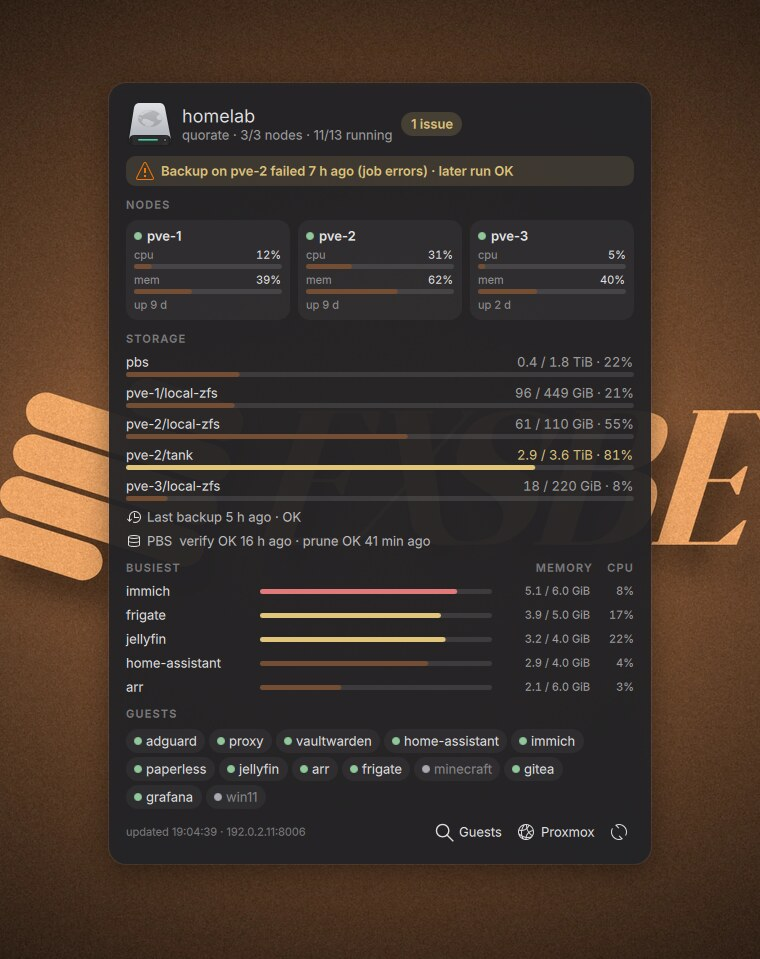
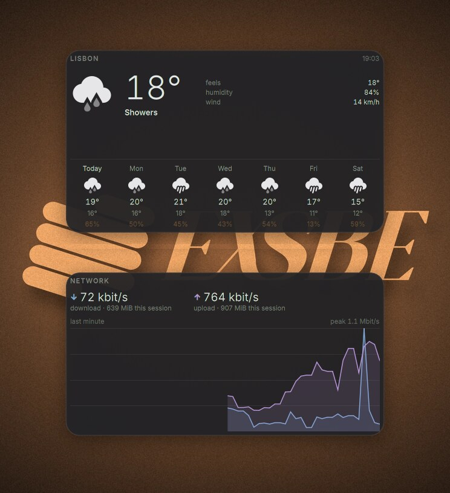
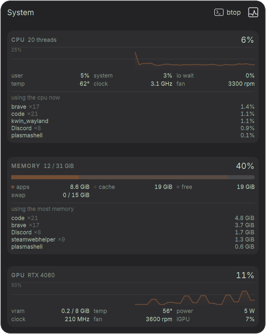
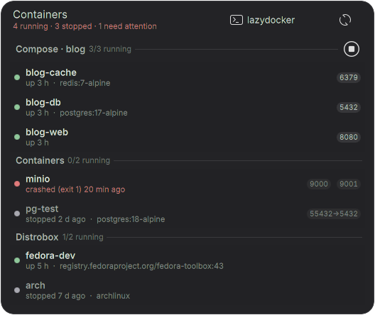
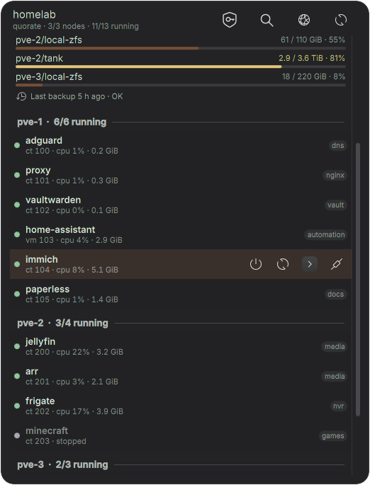
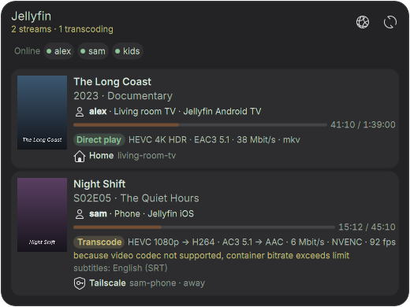
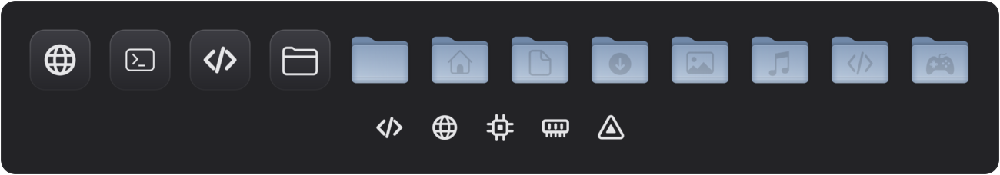
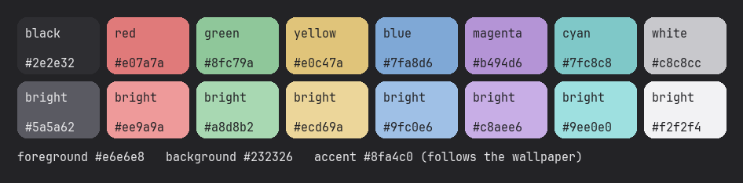

# Exsbe

A graphite KDE Plasma 6 desktop for [Bazzite](https://bazzite.gg), built around the Exsbe logo and
wallpapers: a slim top bar of live status chips, an auto-hiding dock, four purpose-built
workspaces, desktop cards, a home-lab dashboard for Proxmox and Jellyfin, and one palette carried
through the terminal, the editor, the boot splash and the login screen.

Everything installs at user level with one script, can be applied in sections, and keeps
site-specific values (addresses, keys, locations) out of the repository.

<p align="center"></p>

<p align="center">
  
  
</p>

> Screenshots of the Lab, Proxmox, Jellyfin and Containers widgets use sample data
> ([docs/sample.py](docs/sample.py)), not a real cluster. They are rendered from the widgets
> themselves by [docs/shoot.py](docs/shoot.py).

## Contents

- [Components](#components)
  - [Top bar](#top-bar) · [System](#system) · [Containers](#containers) · [Proxmox](#proxmox) ·
    [Jellyfin](#jellyfin) · [Lab dashboard](#lab-dashboard) · [Weather and network](#weather-and-network-cards)
  - [Workspaces and window rules](#workspaces-and-window-rules) · [Dock and icons](#dock-and-icons) ·
    [Wallpapers](#wallpapers) · [Boot and login splash](#boot-and-login-splash)
  - [Colours, terminal and apps](#colours-terminal-and-apps) · [KRunner and pickers](#krunner-and-pickers) ·
    [Game mode](#game-mode) · [Polish](#polish)
- [Requirements](#requirements)
- [Install](#install) · [Lab setup](#lab-setup)
- [Shortcuts](#shortcuts) · [Commands](#commands) · [Background services](#background-services)
- [Customising](#customising) · [Undo and backups](#undo-and-backups)
- [Repository layout](#repository-layout) · [Regenerating the screenshots](#regenerating-the-screenshots)

## Components

### Top bar

A floating 34 px bar: the Exsbe logo opens the launcher, then the workspace switcher, the app
menu, the clock in the middle, and on the right the Exsbe status chips and the system tray.
Every chip has the same shape (icon, value, dim detail) and a fixed width, so the bar never
shifts as numbers change. A chip only takes colour when something needs you: amber means worth a
look, red means broken.

| Chip | Shows | Click |
| --- | --- | --- |
| System | CPU % and temperature, RAM %, GPU % and temperature (dimmed while the dGPU sleeps) | [System](#system) popup |
| Containers | running / total; `n !` in red when one has crashed or is unhealthy | [Containers](#containers) popup |
| Proxmox | running guests / total; `n !` amber or red when the cluster has problems | [Proxmox](#proxmox) popup |
| Jellyfin | streams playing; the icon turns amber while anything transcodes | [Jellyfin](#jellyfin) popup |

### System



CPU, memory and GPU from Plasma's own sensors (ksystemstats).

- **Graphs** of the last minute that rescale to the load (10 / 25 / 50 / 100 %, labelled), so an
  idle machine still shows its shape.
- **Facts**: user / system / io wait, temperatures, clocks, fan speeds, VRAM, power, iGPU.
- **Memory bar**: apps, cache and free, with a matching legend.
- **Busiest programs**, refreshed every 2 s while the popup is open. CPU is measured between two
  samples of `/proc` (not `ps`'s lifetime average) as a share of the whole machine, and a
  program's helper processes are added up into one row (`brave ×19`).
- **btop** and System Monitor one click away.

Warnings: CPU amber from 85 % or 85 °C, red from 97 % or 95 °C; GPU from 80 / 87 °C.

<br clear="right">

### Containers



Local Podman containers, compose stacks, pods and distroboxes.

- Grouped by compose project or pod, each group with its running count and a button that
  **starts or stops the whole stack**. Distroboxes come last.
- Plain status: `up 3 h`, `stopped 2 d ago`, and `crashed (exit 1) 20 min ago` in red. A normal
  stop (exit 0, 130, 137, 143) is never shown as a failure; unhealthy containers are.
- Image only when it adds something (`:latest` and a repeat of the name are dropped); published
  ports as chips (`8080`, `55432→5432`).
- Hover a row: start / stop, restart, shell (`podman exec`, or `distrobox enter`), logs.
- Containers run in their own systemd scope, so restarting Plasma never stops them.
- **lazydocker** on the Podman socket from the header (also **Meta+Shift+C**).

<br clear="right">

### Proxmox



The cluster through `exsbe-pve status` (an API token kept in KWallet).

- **Problems first**: offline nodes, lost quorum, full storage, failed backups, Proxmox Backup
  Server jobs. A failed backup that a later run fixed is amber ("later run OK"), not red.
- **Nodes** as cards with CPU and memory, **storage** pools with usage bars (amber from 75 %,
  red from 85 %) and when the last backup ran.
- **Guests per node** with CPU and memory, and their distinctive tags (a tag nearly every guest
  carries is left out). Hover for start / shut down / reboot (asks twice), console, SSH; click to
  open the guest in the Proxmox web UI.
- Header: Tailscale on / off, the guest picker, the web UI.

<br clear="right">

### Jellyfin



Every active stream on the server, for all users, through `exsbe-jellyfin status`.

- Poster, title, who and on which device, progress.
- **How it plays**: Direct play (green), Direct stream, or Transcode (amber) with the codec
  changes, bitrate, hardware encoder and frame rate, and **why** it transcodes in plain words.
- **Where from**: Home (with the device's LAN name), Tailscale, or the internet with city / ISP.
  Viewers seen only through a reverse proxy are flagged.
- Who is online right now, as chips. When nothing plays, the popup stays short.

<br clear="right">

### Lab dashboard

A desktop card for the Proxmox cluster at a glance, shown only on the **Lab** workspace (and
polling only there): status pill, problems, node cards, storage, Proxmox Backup Server verify and
prune jobs, the five guests using the most memory (memory and CPU columns, amber / red bars), and
every guest as a chip (click to open it). The card is only as tall as its content.

### Weather and network cards

Desktop cards on the theme's widget background:

- **Weather** from [Open-Meteo](https://open-meteo.com) (no API key): now, feels like, humidity,
  wind, and a 7-day forecast with rain chances, in monochrome weather icons. Set the place with
  right-click > Configure; the [wallpaper and night light](#wallpapers) follow its sunrise and sunset.
- **Network**: download and upload rates, a one-minute graph of both, totals for the session.

### Workspaces and window rules

Four workspaces with their own icon: **Code**, **Web**, **Lab**, **Play**. The switcher in the
bar shows the current one as an accent pill with its name; the others collapse to their icon,
dimmed when they have no windows. Apps open where they belong:

| Workspace | Opens there | Extras |
| --- | --- | --- |
| Code | VS Code | the dock's terminal opens a kitty session in `~/projects` |
| Web | Brave | |
| Lab | the Proxmox app window, Termius, Moonlight | Lab dashboard; terminal session with a shell, btop and `exsbe-pve` |
| Play | Steam, games, Lutris, Heroic, gamescope | [game mode](#game-mode) |

**Meta+T** opens the tiling editor with a 60 / 40 layout (editor left, two stacked tiles right)
on every workspace and screen.

### Dock and icons



An auto-hiding dock that gets out of the way of windows: Brave, kitty, VS Code and Dolphin, each a
graphite tile with a light glyph in the same line weight as the workspace icons. The **Exsbe**
icon theme is WhiteSur-dark with graphite folders, the dock tiles, and bar glyphs drawn for it
(CPU, memory, the `</>` and globe of the Code and Web workspaces, the Jellyfin mark).

Homebrew rewrites the VS Code and kitty launchers on every upgrade; a watcher
(`exsbe-launchers.path`) puts the themed tile and the workspace-aware terminal back at once.

### Wallpapers


Seven designs. Each day of the week gets a different one, reshuffled every week
(`exsbe-wallpaper --week` shows the line-up). Each design has five images that follow the sun at
your location: dawn, solar noon, half an hour before sunset, after dark, and midnight. The lock
screen follows, and the accent colour is taken from the current image.


The times come from Plasma's Night Time service, so the evening image and night light's warm
screen arrive together at the real sunset. `exsbe-wallpaper --today` shows today's times.

### Boot and login splash


The Exsbe lockup assembles itself on softly lit graphite: the five bars slide in along their own
17.63° axis from alternating sides, the wordmark rises into place along its italic slant, then a
soft light runs down the bars for as long as the system is loading.

The same animation, frame for frame, from power-on to desktop: a Plymouth boot theme (packaged as
an RPM for Bazzite's read-only system, with a themed passphrase prompt and boot messages), the
login screen on the same graphite, and the Plasma splash after login. Bars and letters are cut
from [plymouth/logo.svg](plymouth/logo.svg) by `plymouth/gen.py`, so a logo change is one command
away.

### Colours, terminal and apps



One palette everywhere, generated as the **Exsbe** colour scheme (accent from the wallpaper) and
a rounded **Plasma style** (rounded dock items and pager, desktop cards).

| App | What it gets |
| --- | --- |
| kitty | palette, rounded tabs, per-workspace sessions (`exsbe-term`) |
| Konsole | colour scheme and profile |
| VS Code | settings merged in (your own are kept) |
| zsh / fzf / bat / eza | graphite fzf with bat previews, eza and syntax-highlighting colours |
| Starship | bright defaults swapped for the palette |
| btop, lazygit, lazydocker | Exsbe themes |
| fastfetch | system info with the Exsbe logo when kitty opens |
| MangoHud | Exsbe overlay in every Vulkan game, hidden until **Right Shift+F12** |
| GTK / Flatpak | Breeze in dark, Inter and JetBrains Mono, icons and cursor readable from Flatpaks |

Window decorations are Breeze (it tells KWin its corner radius, so window contents are rounded
too); a graphite Aurorae decoration is installed as an alternative.

### KRunner and pickers

- **KRunner** (Alt+Space) gains the lab: type a guest's name (or `pve name`) and Enter opens a
  shell in it; `ssh host` connects to any host from your SSH config; `jf title` searches the
  Jellyfin library.
- **Guest picker** (Meta+Shift+P): fzf over every VM and container with a live details pane;
  Enter opens a shell (containers through `pct enter`, VMs over SSH or the noVNC console), with
  keys to start, shut down, reboot, open the console or the web UI.
- **SSH picker** (Meta+Shift+H): every host from `~/.ssh/config` and `known_hosts`, or type a new one.

### Game mode

Switching to **Play** turns off blur and contrast effects, lets the dock fully hide, and holds
Do Not Disturb; leaving Play restores all three.

### Polish

Quicker animations (windows scale in and out, minimise into the dock like a genie); tapping Meta
opens Overview; KRunner floats in the middle of the screen; notifications appear top right, last
5 s, and stay quiet in fullscreen and while sharing the screen; a 100-item clipboard history on
Meta+V; and **Exsbe chimes**, a soft sound theme synthesised by `sounds/gen.sh`.

## Requirements

- **Bazzite** (or another Fedora Atomic KDE) with **Plasma 6.5+**
- **Homebrew** for the terminal tools
- Fonts: Inter Variable, JetBrainsMono Nerd Font
- Themes: WhiteSur-dark icons, WhiteSur-cursors
- Apps: kitty, fzf, btop, lazygit, fastfetch, zsh (bat and eza optional)
- Containers: podman, lazydocker · Lab: jq, tailscale, ssh

`./install.sh check` lists what is installed and missing, with where to get each. Every install
runs the same check for the sections it is about to apply, and stops only when a core tool is missing.

## Install

```sh
git clone https://github.com/MeAshikeqbal/exsbe-theme && cd exsbe-theme
./install.sh check           # what is installed / missing
./install.sh                 # everything, at user level (no sudo)
./install.sh apps workflow   # or only some sections
```

| Section | What it applies |
| --- | --- |
| `colors` | Exsbe colour scheme, accent from the wallpaper |
| `desktop` | fonts, Plasma style, Exsbe icons and cursor, Breeze decoration with rounded corners, blur, the four workspaces, GTK / Flatpak theming |
| `apps` | Konsole, VS Code, Starship, kitty, MangoHud, shell colours, fastfetch, lazygit, btop, dock launchers |
| `containers` | Containers widget, lazydocker on Podman (Meta+Shift+C) |
| `splash` | Plasma splash and global theme, wallpapers and their timer |
| `workflow` | window rules, tiling layout, game mode, config backups, SSH picker, clipboard, night light |
| `polish` | animations, Meta for Overview, KRunner, notifications, sounds |
| `lab` | Proxmox and Jellyfin tools and widgets, KRunner plugin, Lab dashboard, Tailscale route switching (see [Lab setup](#lab-setup)) |
| `layout` | **replaces all panels** with the top bar and dock, adds the System, weather and network widgets |

The boot splash and login screen are system-level and need root:

```sh
rpm/build.sh                 # build the Plymouth theme RPM in a throwaway container
sudo ./install-boot.sh       # layer it (or replace an older build) and theme the login screen; reboot
```

Wallpapers are copied to `~/Pictures/Wallpapers/exsbe/` (existing files are kept). After
installing, set your location in the weather card so the wallpaper and night light follow your
sunset.

## Lab setup

The lab tools talk to Proxmox with least-privilege API tokens. Secrets go straight into KWallet
and are never printed or written to disk; addresses live in `~/.config/exsbe/pve.conf`, which
stays on your machine.

```sh
cp lab/pve.conf.example ~/.config/exsbe/pve.conf     # 1. your endpoints, LAN, Jellyfin, router MAC
bin/exsbe-pve-setup root@<node> --pbs root@<pbs>     # 2. users + tokens on the cluster (and PBS)
bin/exsbe-secret jellyfin                            # 3. Jellyfin API key (Dashboard > API Keys)
./install.sh lab                                     # 4. tools, widgets, timers
exsbe-pve-keys                                       # 5. optional: your SSH key into every container
```

Endpoints are tried in order (a reverse-proxy name first, then node IPs checked against the
cluster CA). Away from home, `exsbe-tailnet-routes` accepts the lab's Tailscale route, and only
then: "home" is recognised by your router's MAC, not by its address.

## Shortcuts

| Keys | Action |
| --- | --- |
| Meta (tap) | Overview |
| Alt+Space | KRunner, with guests, `ssh` and `jf` |
| Alt+F1 | app launcher |
| Meta+V | clipboard history |
| Meta+T | tiling layout editor |
| Meta+Shift+P | Proxmox guest picker |
| Meta+Shift+H | SSH host picker |
| Meta+Shift+C | lazydocker on Podman |
| Right Shift+F12 | MangoHud overlay in games |

## Commands

| Command | Does |
| --- | --- |
| `exsbe-wallpaper` (`--today`, `--week`, `--force`) | apply the wallpaper for now; show today's sun times or this week's designs |
| `exsbe-config-backup` (`log`, `diff`, `restore REV`) | snapshot the desktop config into a local git repo; list, compare, restore |
| `exsbe-pve status \| list \| info \| connect \| do \| console \| web \| ssh-config \| alerts` | the Proxmox CLI behind the widgets and pickers |
| `pvepick`, `sshpick` | the guest and SSH pickers |
| `exsbe-jellyfin status \| web` | Jellyfin sessions as JSON; the web UI as an app window |
| `exsbe-pve-setup`, `exsbe-pve-keys`, `exsbe-secret` | one-time lab setup |
| `exsbe-term` | kitty with the session for the current workspace |
| `lazypod` | lazydocker on the rootless Podman socket |
| `exsbe-launchers` | re-theme the dock launchers (run automatically) |

## Background services

All user units; nothing runs as root.

| Unit | When | Does |
| --- | --- | --- |
| `exsbe-wallpaper.timer` | every 5 min, at login | changes the image when the part of the day changes |
| `exsbe-launchers.path` | when Homebrew rewrites a launcher | puts the themed VS Code tile and kitty launcher back |
| `exsbe-config-backup.timer` | 03:00 daily | snapshot of the desktop config (only commits changes) |
| `exsbe-pve.timer` | every 5 min | cluster alerts as notifications; SSH config for every guest |
| `exsbe-tailnet-routes.service` | always, on network changes | Tailscale lab route only when away from home |
| `exsbe-dnd.service` | while on Play | holds Do Not Disturb |

## Customising

- **Location** for weather, wallpaper and night light: weather card > Configure.
- **Night light schedule**: pick fixed times in System Settings and the wallpaper follows those instead.
- **Workspaces**: names and icons in `plasmoid/com.exsbe.workspaces`; window rules in the
  `workflow` section of `install.sh`; terminal sessions in `kitty/sessions/<workspace>.kitty`.
- **Colours**: `colors/gen-colors.sh` (scheme), `plasma-style/gen.py` (Plasma style),
  `icons/gen-folders.sh` and `icons/gen-apps.py` (icon theme), `sounds/gen.sh` (chimes).
- **Logo / splash**: replace `plymouth/logo.svg` (keep one element per bar and wordmark shape),
  run `plymouth/gen.py`, then `./install.sh splash`, `rpm/build.sh` and `sudo ./install-boot.sh`.
- **Wallpapers**: add a folder with `1-morning` … `5-midnight` images to `wallpapers/` and run
  `./install.sh splash`; the weekly shuffle picks it up.

## Undo and backups

- Once the `workflow` section is installed, `exsbe-config-backup` keeps a nightly git history of
  the desktop config: `exsbe-config-backup log`, then `exsbe-config-backup restore REV` (the current
  state is saved first, so a restore can itself be undone).
- `./restore.sh [backup.tar.gz]` restores a tarball of `~/.config` that you made before
  installing. `install.sh` does not create one, so make it yourself first if you want this path,
  e.g. `tar czf ~/exsbe-theme-backup-$(date +%F).tar.gz -C ~/.config .`
- Boot splash: `sudo rpm-ostree uninstall exsbe-plymouth`.

## Repository layout

| Path | What |
| --- | --- |
| `install.sh`, `install-boot.sh`, `restore.sh` | user-level installer (sections, dependency check), system-level splash and login, restore |
| `layout.js` | top bar and dock |
| `colors/`, `plasma-style/`, `aurorae/` | colour scheme generator, rounded Plasma style, alternative window decoration |
| `icons/` | Exsbe icon theme generator: graphite folders, dock tiles, symbolic glyphs |
| `plasmoid/com.exsbe.*` | widgets: `workspaces`, `sysmon`, `containers`, `proxmox`, `jellyfin`, `lab`, `weather`, `network` |
| `kwin/exsbe-gamemode` | KWin script for game mode |
| `krunner/`, `bin/exsbe-krunner` | KRunner plugin over D-Bus |
| `bin/` | `exsbe-*` tools, pickers, lazydocker wrapper, VS Code settings merge |
| `lab/pve.conf.example` | template for `~/.config/exsbe/pve.conf` (local, never committed) |
| `systemd/` | the user units above |
| `kitty/`, `konsole/`, `btop/`, `lazygit/`, `lazydocker/`, `fastfetch/`, `mangohud/`, `shell/` | app themes and configs |
| `look-and-feel/`, `plymouth/`, `rpm/` | Plasma splash and global theme; the logo source, splash image generator, Plymouth theme and its RPM build |
| `sounds/` | the Exsbe chime sound theme and its generator |
| `wallpapers/` | seven designs × five times of day |
| `docs/` | screenshots, their sample data and the script that renders them |

## Regenerating the screenshots

```sh
docs/shoot.py                  # everything, into docs/img/
docs/shoot.py system topbar    # or some: topbar system containers proxmox jellyfin lab desktop
                               #          wallpapers splash icons palette
```

The splash is rendered frame by frame from its own QML with the clock stepped by hand. Each
widget is installed as a temporary copy, opened in its own window for a few seconds and
grabs itself, so the images are exactly what Plasma draws with the installed theme. The lab,
media and container widgets read [docs/sample.py](docs/sample.py) instead of the real commands,
and the weather card shows Lisbon, so no real names, addresses or places end up in the repository.
